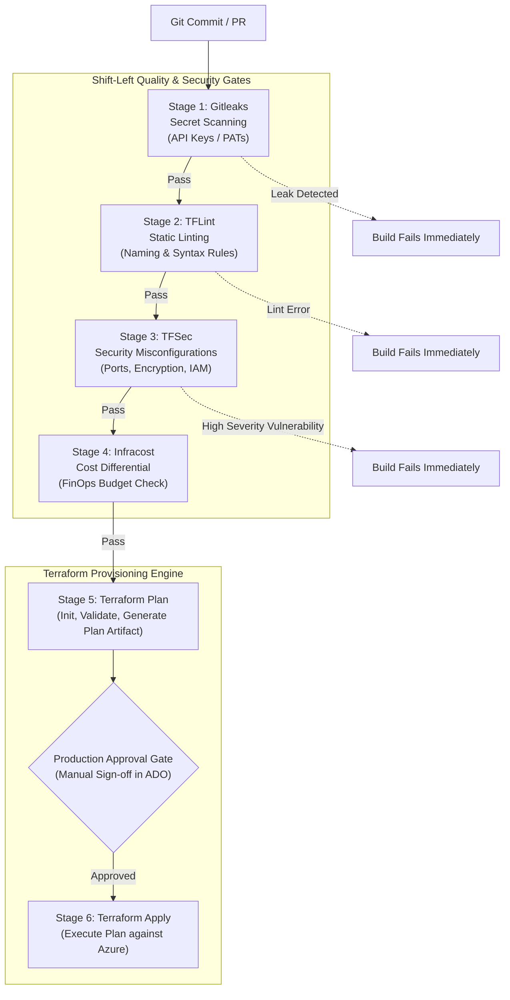

# Automated Azure DevSecOps Pipeline

[](https://azure.microsoft.com/en-us/products/devops/pipelines/)
[](https://www.terraform.io/)
[](https://github.com/gitleaks/gitleaks)
[](https://github.com/terraform-linters/tflint)
[](https://aquasecurity.github.io/tfsec/)
[](https://www.infracost.io/)

A battle-tested, production-ready **Multi-Stage DevSecOps Pipeline** on **Azure DevOps** that enforces shift-left security, static code quality, vulnerability analysis, and cloud cost forecasting before any Terraform code is applied to Microsoft Azure.

---

## 🛡️ Pipeline Architecture & Quality Gates

Every pull request and merge into the default branch must pass through 4 automated gates before proceeding to infrastructure execution:



---

## 🔍 Stage-by-Stage Breakdown

### 1. Secret Scanning (Gitleaks)
* **Goal**: Detect committed credentials, private keys, Azure Service Principal secrets, or Personal Access Tokens (PATs).
* **Behavior**: Scans commit diffs and full Git history. If any entropy rule matches, the pipeline fails before code is shared or packaged.

### 2. Static IaC Linting (TFLint)
* **Goal**: Enforce Terraform provider best practices, verify valid Azure VM SKUs, ensure correct attribute types, and catch deprecated arguments.

### 3. Vulnerability Scanning (TFSec)
* **Goal**: Detect dangerous cloud configurations before deployment (e.g., storage accounts with public blob access, unencrypted disks, open `0.0.0.0/0` security group rules).

### 4. Cloud Cost Estimation (Infracost)
* **Goal**: FinOps visibility. Integrates with the Cloud Pricing API to calculate exact monthly cost deltas resulting from the proposed Terraform changes.

### 5. Terraform Init, Validate & Plan
* **Goal**: Connects securely to the Azure RM remote backend in Azure Blob Storage, validates syntax, generates an execution plan, and archives the `tfplan` artifact.

### 6. Production Manual Approval & Apply
* **Goal**: Enforces zero unreviewed production changes. Senior engineers inspect the generated `tfplan` artifact and provide one-click sign-off in Azure DevOps Environments before `terraform apply` executes.

---

## 📁 Repository Structure

```text
├── .gitignore                   # Ignores local state, .terraform, and secrets
├── azure-pipelines.yml          # Production 6-stage DevSecOps pipeline
├── provider.tf                  # Parameterized AzureRM provider & backend
├── variables.tf                 # Variable declarations with typing & descriptions
├── outputs.tf                   # Infrastructure output definitions
├── terraform.tfvars.example     # Safe sample variable configuration
└── README.md                    # Technical documentation
```

---

## 💻 Local Execution & Testing

Before committing changes, run the local verification suite:

```bash
# 1. Format and check Terraform code
terraform fmt -check -diff

# 2. Run Gitleaks locally
gitleaks detect --source . -v

# 3. Run TFLint
tflint --init && tflint

# 4. Run TFSec
tfsec .

# 5. Validate Terraform syntax
terraform init -backend=false
terraform validate
```

---

## 🔐 Azure DevOps Service Connection Setup

1. In Azure DevOps Project Settings, create an **Azure Resource Manager Service Connection** (Workload Identity Federation or Service Principal).
2. Create an **Azure Storage Account** with a container for Terraform remote state (`azurerm_storage_container`).
3. Set pipeline variables in Azure DevOps:
   * `azureServiceConnection`: Service connection name (e.g., `testing-axion-service-connection`)
   * `tfStateResourceGroup`: Resource group holding remote state storage
   * `tfStateStorageAccount`: Storage account name
   * `tfStateContainer`: Blob container name (`axion-tfstate`)
   * `tfStateKey`: State file key (`axion.terraform.tfstate`)

---

## 👨‍💻 Maintainer

**Samarendra Kumar**  
Senior Azure DevOps & Cloud Platform Engineer  
GitHub: [@samarendra12](https://github.com/samarendra12)
